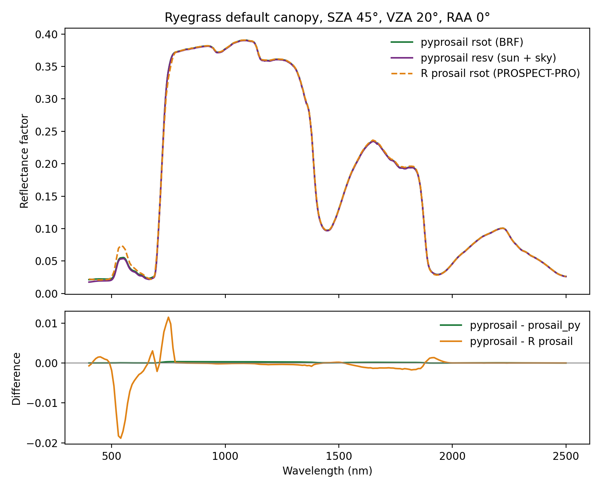
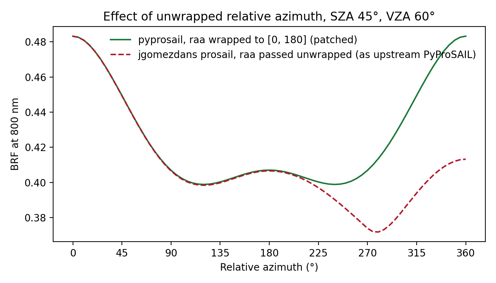

# PROSAIL implementation review and cross-check

*Perennial ryegrass BRDF project. Review date: 2026-11-06.*

## Summary

- **Physics: no numerical bug found.** PyProSAIL ([EOA-team/PyProSAIL](https://github.com/EOA-team/PyProSAIL)) and the hsdar R package contain the same PROSAIL Fortran (PROSPECT-5B + 4SAIL). A source diff and a value-by-value comparison of all 11 spectral data arrays found no differences in the physics or the data.
- **PyProSAIL's wrapper and build had six defects** (§2): a wrong LIDF check, no relative-azimuth wrapping, a mislabelled output, stale documentation, no input validation, and a build that fails on NumPy 2 / Python ≥ 3.12. All are fixed in the vendored copy [vendor/pyprosail](../vendor/pyprosail) ([PATCHES.md](../vendor/pyprosail/PATCHES.md)), which is now the project's PROSAIL engine.
- **The relative-azimuth (psi) bug also affected this project.** The jgomezdans `prosail` package has the same problem, and the original [BRDF.qmd](../BRDF.qmd) passed relative azimuths up to 360°. For raa > 180°, single scattering was wrong by up to 25 % at 670 nm and 14 % at 800 nm (SZA 45°, VZA 60°). At raa = 360°, which is physically the same as 0°, the BRF was 15 % low (§4.2).
- **R `prosail` (PROSPECT-PRO) differs in the leaf model.** It is brighter by up to 0.057 at the green peak and differs at the 750 nm red-edge shoulder (§4.4). That is a model-version difference, not a bug.
- **Python implementations agree.** On 135 canopy × geometry cases, the patched PyProSAIL and jgomezdans `prosail` agree within 4e-4 RMSD in reflectance, and within 3.3e-3 at worst. The worst cases are at VZA = 80° (§4.1).
- **Choice of output matters.** `resv` (sun + sky, what PyProSAIL and hsdar return) and `rsot` (BRF under direct sun) give very different anisotropy in the visible. At SZA 60°, the 480 nm hotspot-to-forward ratio is 11.0 for `rsot` but 3.8 for `resv` (§4.3). Figures and the manuscript must say which one they use.

## 1. Implementations compared

| Implementation | Language | Leaf model | Canopy model | Status in this project |
|---|---|---|---|---|
| hsdar `PROSAIL()` (CRAN, archived) | R → Fortran | PROSPECT-5B | 4SAIL | Reference source only; it is not installable because it depends on the retired `rgdal` |
| PyProSAIL (EOA-team, `0470fd7`) | Python → Fortran (f2py) | PROSPECT-5B | 4SAIL | Vendored, patched and used as the engine |
| `prosail` 2.0.5 (jgomezdans, PyPI) | Pure Python | PROSPECT-5 / D | 4SAIL | Dev dependency: cross-check and fallback backend |
| `prosail` (jbferet, GitLab) | Pure R | PROSPECT-PRO | 4SAIL / 4SAIL2 | renv; R cross-check |

## 2. PyProSAIL vs hsdar

### 2.1 Identical code

These were diffed with comments and whitespace removed:

- `PRO4SAIL.f90`, `MODULE_PRO4SAIL.f90`, `LIDF.f90`, `volscatt.f90`, `dladgen.f`, `prospect_5B.f90` and `tav_abs.f90` differ only in type spellings (`REAL*8` vs `DOUBLE PRECISION`) and module names.
- The spectral data arrays (`lambda`, refractive index, `k_Cab`, `k_Car`, `k_Brown`, `k_Cw`, `k_Cm`, `Es`, `Ed`, `Rsoil1`, `Rsoil2`) have 0 differing values out of 2101 each. `Rsoil1` is the dry soil, so `psoil = 1` means dry.

These parts were checked and found correct:

- the hotspot handling (q = 0, and dso = 0 at the exact hotspot);
- the near-singular `Jfunc1` branch;
- the LIDF bin edges and normalisation;
- the soil coupling equations;
- the skylight formula;
- the per-call reset of the optimisation flags.

One cosmetic quirk is common to both: `pi = ATAN(1.)*4.` is single precision, with a relative error of about 1e-7.

### 2.2 Defects in the PyProSAIL wrapper and build

| # | Defect | Effect | Fix in `vendor/pyprosail` |
|---|---|---|---|
| 1 | The LIDF check tests `lidfa + lidfb > 1` instead of `abs(lidfa) + abs(lidfb) > 1` | Pairs such as (0.5, −0.8) pass and give negative LIDF weights, so extinction and scattering are non-physical | Check fixed; such pairs raise `ValueError` |
| 2 | psi is not wrapped | `volscatt` assumes 0 ≤ psi ≤ 180, but the hotspot term uses only cos(psi). psi = 350 and psi = 10 then disagree by up to 25 % (§4.2) | psi is wrapped onto [0, 180] |
| 3 | The output is documented as a "bi-directional reflectance factor" but is `resv`, a sky-light-weighted mix of `rdot` and `rsot` | The BRDF is damped and the hotspot flattened in the visible (§4.3). `rsot`, `rdot`, `rsdt` and `rddt` were not available | `run_all()` returns all five; `run()` keeps the upstream output |
| 4 | The docs describe the legacy API: different arguments, output in µm | Code written from the docs fails, or silently gets nm instead of µm | Docstrings rewritten |
| 5 | `setup.py` uses `numpy.distutils`, which NumPy 2 and Python 3.12 removed. The Makefile build breaks `from _prosail_model import run`. The classifier is invalid and `egg-info` is committed | Cannot be installed on a current stack | meson-python + f2py build with a hand-written `.pyf`. The gfortran runtime is linked statically on Windows |
| 6 | No input validation | tts or tto = 90° gives Inf/NaN; psoil outside [0, 1] can give negative soil reflectance | Inputs are validated (`ValueError`) |

Two features were added: hsdar's custom-soil option (`soil_spectrum=`), and guarded deallocation.

Two possible problems could not be confirmed:

- The Fortran keeps its state in module variables, so it is not thread-safe. Use processes, not threads, for parallel runs.
- f2py does not vectorise; pass scalars only.

## 3. Defects in this repository (before this change)

| File | Defect | Status |
|---|---|---|
| `BRDF.qmd` | raa 0–360 passed unwrapped to jgomezdans `prosail` (same psi bug) | Fixed: the engine wraps raa |
| `BRDF.qmd` | vza grid went to 90°, which is singular in 4SAIL | vza now 0–80° |
| `BRDF.qmd` | Plotted `rsot` (`factor="SDR"`) without saying it excludes diffuse sky light | Both `rsot` and `resv` are now shown and explained |
| `shinyapp/app.R` | Called `prosail::run_prosail()`, which does not exist. The R function is `prosail::prosail()`; it returns a list and takes a soil *spectrum* as `rsoil`, with no `psoil` | Replaced by the Streamlit app |
| `shinyapp/app.R` | `geom_raster()` with `coord_polar()` is not supported by ggplot2 | Replaced |
| `shinyapp/` + shinylive | webR cannot load GitLab or archived packages (jbferet `prosail`, hsdar) | Replaced by the Streamlit app |
| `.vscode/settings.json` | R path pointed to 4.3.2; 4.6.1 is installed | Fixed |
| `.venv` | Base interpreter (CPython 3.11.11) had been removed | Rebuilt on Python 3.12 |

## 4. Cross-check results

Run `uv run python scripts/crosscheck_prosail.py` and `Rscript scripts/crosscheck_prosail.R`. Outputs go to `results/logs/crosscheck_*.csv` and `results/figures/crosscheck_*.png`.

The case matrix was:

- 3 canopies:
  - ryegrass default: LAI 2.5, mean leaf angle 60°, Cab 40;
  - sparse erect: LAI 0.8, 70°, Cab 30;
  - dense planophile: LAI 5, 30°, Cab 55, hspot 0.1;
- SZA ∈ {20, 45, 60}°;
- VZA ∈ {0, 20, 40, 60, 80}°;
- RAA ∈ {0, 90, 180}°.

That gives 135 cases. Soil is the Fortran's built-in spectra mixed with psoil = 0.5 in every implementation.

### 4.1 Patched PyProSAIL vs jgomezdans `prosail`

Maximum absolute difference, with mean RMSD in brackets, in reflectance units:

| Factor | VIS 400–700 | Red edge 700–750 | NIR 750–1300 | SWIR 1300–2500 |
|---|---|---|---|---|
| `rsot` | 9.0e-4 (5.9e-5) | 3.1e-3 (2.8e-4) | 3.3e-3 (3.6e-4) | 3.2e-3 (1.9e-4) |
| `resv` | 6.5e-4 (4.2e-5) | 2.3e-3 (2.4e-4) | 2.9e-3 (3.3e-4) | 2.9e-3 (1.7e-4) |
| `rdot` | 9.8e-5 (1.9e-5) | 6.5e-4 (1.4e-4) | 6.7e-4 (1.9e-4) | 5.0e-4 (7.5e-5) |
| `rsdt` | 5.8e-5 (1.4e-5) | 4.1e-4 (8.6e-5) | 4.3e-4 (1.2e-4) | 3.1e-4 (4.9e-5) |
| `rddt` | 1.6e-5 (7.1e-6) | 1.0e-5 (4.6e-6) | 1.3e-5 (6.4e-6) | 2.9e-5 (1.6e-5) |

Both use the same soil spectra (they are identical) and nominally the same model. For `rsot`, the difference is ≤ 8e-4 for VZA ≤ 40° and grows to 3.3e-3 at VZA = 80°. That points to small numerical differences in the directional terms, with larger effects at grazing view. The differences are well below field measurement uncertainty. The test suite pins agreement within 2e-3 for VZA ≤ 70°.

### 4.2 Unwrapped relative azimuth

jgomezdans `prosail` was called directly with raa and 360° − raa, which should give identical results. Relative error in `rsot`:

| Wavelength | Range of relative error over SZA {30, 45}°, VZA {20, 40, 60}°, raa {10, 30, 60, 120}° |
|---|---|
| 670 nm | −24.9 % … −0.1 % |
| 800 nm | −14.3 % … −0.2 % |

### 4.3 `resv` vs `rsot`: anisotropy damping

The table gives the ratio of the hotspot BRF to the BRF at the same VZA in the forward-scatter direction, in the principal plane with VZA = SZA, for the ryegrass default canopy.

| SZA | Wavelength (nm) | `rsot` | `resv` |
|---|---|---|---|
| 20° | 480 | 2.69 | 2.11 |
| 20° | 670 | 2.85 | 2.53 |
| 20° | 800 | 1.47 | 1.37 |
| 45° | 480 | 5.23 | 3.19 |
| 45° | 670 | 4.94 | 3.91 |
| 45° | 800 | 1.69 | 1.56 |
| 60° | 480 | 11.00 | 3.77 |
| 60° | 670 | 8.10 | 4.84 |
| 60° | 800 | 1.72 | 1.56 |
| 60° | 1650 | 1.73 | 1.67 |

### 4.4 Patched PyProSAIL vs R `prosail` (jbferet 3.2.0, PROSPECT-PRO)

The R spectra were compared every 10 nm, using the same soil spectrum and leaf contents (`lma = cm`, `ewt = cw`, `prot = cbc = 0`, `ant = 0`). Maximum absolute difference, with mean RMSD in brackets:

| Factor | VIS 400–700 | Red edge 700–750 | NIR 750–1300 | SWIR 1300–2500 |
|---|---|---|---|---|
| `rsot` | 5.7e-2 (7.9e-3) | 3.1e-2 (6.2e-3) | 3.8e-2 (3.0e-3) | 2.3e-2 (1.4e-3) |
| `rdot` | 3.2e-2 (7.9e-3) | 1.7e-2 (5.8e-3) | 2.2e-2 (2.5e-3) | 8.4e-3 (1.6e-3) |
| `rsdt` | 2.6e-2 (7.3e-3) | 1.7e-2 (5.7e-3) | 2.2e-2 (2.5e-3) | 5.9e-3 (1.5e-3) |
| `rddt` | 2.6e-2 (8.4e-3) | 1.7e-2 (6.0e-3) | 2.2e-2 (2.7e-3) | 5.9e-3 (1.8e-3) |

These differences come from the leaf model, not from 4SAIL:

- In every case, the largest visible difference is at 530–550 nm, where R `prosail` is brighter by 0.005–0.057.
- The largest NIR difference sits at the 750 nm red-edge shoulder in 121 of 135 cases.
- Both are regions controlled by pigment absorption. PROSPECT-PRO uses the PROSPECT-D specific absorption coefficients for chlorophyll and carotenoids and a recalibrated refractive index, while PyProSAIL uses PROSPECT-5B.
- Beyond 780 nm and at nadir, the two agree within about 1e-3. For example, at SZA 20° nadir, 800 nm gives 0.3357 vs 0.3360 and 2200 nm gives 0.1002 vs 0.1002.
- The SWIR difference grows with VZA (3e-3 at nadir, 2.3e-2 at 80°), which suggests smaller differences in 4SAIL's directional terms as well. That was not investigated further.

The upshot is that results from PyProSAIL and R `prosail` should not be mixed in one analysis without saying so. The leaf-model version shifts green and red-edge reflectance by several percent absolute.

## 5. Recommendations for the manuscript

1. **Report the reflectance factor.** Use `rsot` when describing canopy BRDF physics. Use `resv`, or better a measured diffuse fraction, when comparing with field spectroradiometer data collected under sun and sky. Their anisotropy differs by a factor of about 3 in the blue at SZA 60°.
2. **State the azimuth convention.** In this project raa = 0° is the hotspot (sensor on the sun's side), and raa is wrapped to [0, 180]. Many sensors and 6S use 180° for backscatter.
3. **Treat the hotspot parameter as uncertain.** `hspot` = leaf size / canopy height. 0.01 is a generic default. For ryegrass swards with leaves a few mm wide and 10–30 cm tall it is likely nearer 0.01–0.05, and its effect on the hotspot peak should be shown as a sensitivity analysis.
4. **Limit view zenith.** Report results for VZA ≤ 70–80°. 4SAIL becomes unreliable towards 90°, and implementations already diverge by about 3e-3 at 80°.
5. **Cite the model versions:** PROSPECT-5B (Féret et al., 2008), 4SAIL (Verhoef et al., 2007), PROSAIL (Jacquemoud et al., 2009, doi:10.1016/j.rse.2008.01.026), and the patched PyProSAIL version (`vendor/pyprosail`, 1.0.2+brdf.1).

## 6. Wheat growth-stage parameter table

[data/crop_parameters/growth_stages.csv](../data/crop_parameters/growth_stages.csv) holds PROSAIL inputs for wheat at Z13, Z21, Z25, Z30, Z32, Z39, Z55, Z65, Z75, Z85 and Z92. It covers LAI (min, typical, max), mean leaf angle, plant population, Cab, Car, Cw, Cm, N, Cbrown and hotspot.

- **Sources.** Every value cites a source: 9 DOIs, each checked against Crossref, and 2 grey-literature guides (AHDB 2018, GRDC 2015). The main sources are Xing et al. (2021), O'Leary et al. (2015), Hosoi et al. (2009), Danner et al. (2019), Jiang et al. (2018) and Wang et al. (2022). See [sources.md](../data/crop_parameters/sources.md).
- **Flagged values.** About half the cells are crop-level averages or calculated values, flagged [CROP-LEVEL] or [CALC] in `notes`.
- **Blank cells.** Typical LAI is missing for Z13, Z21, Z25, Z39 and Z85. Pigment and water values are missing for Z85 and Z92. The app does not plot stages without a sourced LAI, and it lists which inputs fell back to the sidebar.
- **Use with care.** The table is meant for exploring realistic ranges, not as calibrated priors for a particular site. Western Australian dryland crops will mostly sit at or below `lai_min`.
