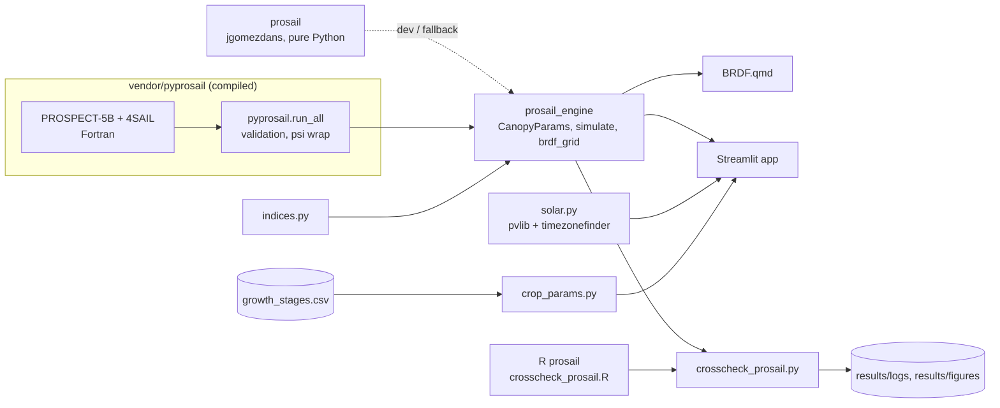

# Architecture

[← Home](Home.md)

## Repository layout

```
Hyperspectral_Data_Analysis/
├── vendor/pyprosail/            Patched PyProSAIL: PROSAIL Fortran + Python wrapper (own build)
│   ├── src/fortran/*.f90, *.f   PROSPECT-5B, 4SAIL, LIDF, spectral data; _prosail_model.pyf (f2py signature)
│   ├── pyprosail/__init__.py    run(), run_all(), ProsailResult, input validation, psi wrapping
│   ├── meson.build, pyproject.toml
│   └── PATCHES.md               Every change against upstream
├── src/publication_spectral_data/
│   ├── prosail_engine.py        CanopyParams, simulate(), brdf_grid(), backends, soil handling
│   ├── indices.py               NDVI, EVI, SAVI, NDRE, GNDVI, MTCI
│   ├── solar.py                 Sun position (pvlib), time zones, relative azimuth
│   └── crop_params.py           Loads the growth-stage table, maps rows to CanopyParams
├── app/streamlit_app.py         PROSAIL BRDF Explorer (three tabs)
├── data/
│   ├── ryegrass-params.yaml     Reference ryegrass parameters
│   └── crop_parameters/         growth_stages.csv, sources.md, README.md
├── scripts/
│   ├── crosscheck_prosail.py    Compares PROSAIL implementations, writes results/
│   ├── crosscheck_prosail.R     Runs the R prosail package on the same cases
│   ├── init_renv.R, register_python_kernel.ps1
├── tests/test_prosail_engine.py
├── BRDF.qmd, article.qmd        Analysis document and manuscript (Quarto)
├── results/figures, results/logs
├── docs/                        This wiki and the implementation review
├── pyproject.toml, uv.lock      Python dependencies (source of truth)
└── renv.lock, renv/, .Rprofile  R dependencies
```

## How the pieces connect



## Layers

1. **Model core** (`vendor/pyprosail`). This is Fortran from Jean-Baptiste Féret's PROSAIL 5B distribution, with the same physics as hsdar. f2py exposes one routine, `run`, which returns five reflectance spectra. The Python wrapper validates the inputs and wraps the azimuth. See [PROSAIL Engine](PROSAIL-Engine.md).
2. **Engine** (`prosail_engine.py`). This is the only layer the rest of the project calls. It:
   - groups the inputs into a `CanopyParams` dataclass;
   - enforces the geometry limits;
   - handles soil brightness;
   - can switch backend between the Fortran (`pyprosail`) and pure-Python (`prosail_py`) implementations;
   - builds BRDF grids.
3. **Helpers.**
   - `indices.py` computes indices from single bands, with no sensor response functions.
   - `solar.py` gives the sun's position for a place and time.
   - `crop_params.py` reads the parameter database.
4. **Front ends.**
   - `BRDF.qmd` produces figures for the paper.
   - `app/streamlit_app.py` is for interactive exploration.
   - `scripts/crosscheck_prosail.*` validates the engine.

## Design rules

- **One engine.** Everything goes through `prosail_engine.simulate` or `brdf_grid`, so the azimuth wrapping, angle limits and soil handling are the same everywhere. Never call `prosail.run_prosail` or `pyprosail.run` with raw 0–360° azimuths.
- **Explicit wavelengths.** Arrays are indexed by `wavelength - 400`, and code says which wavelength it reads.
- **Parameter names follow the manuscript.** Use `N`, `cab`, `car`, `cbrown`, `cw`, `cm`, `lai`, `lidfa`, `hspot`, `psoil`, `sza`, `vza`, `raa`.
- **Reproducibility.** `pyproject.toml` with `uv.lock`, and `renv.lock`, are the only places dependencies are declared.
- **No invented data.** Every value in the parameter database has a source. A blank cell is better than a guess.

Next: [PROSAIL Engine](PROSAIL-Engine.md).
